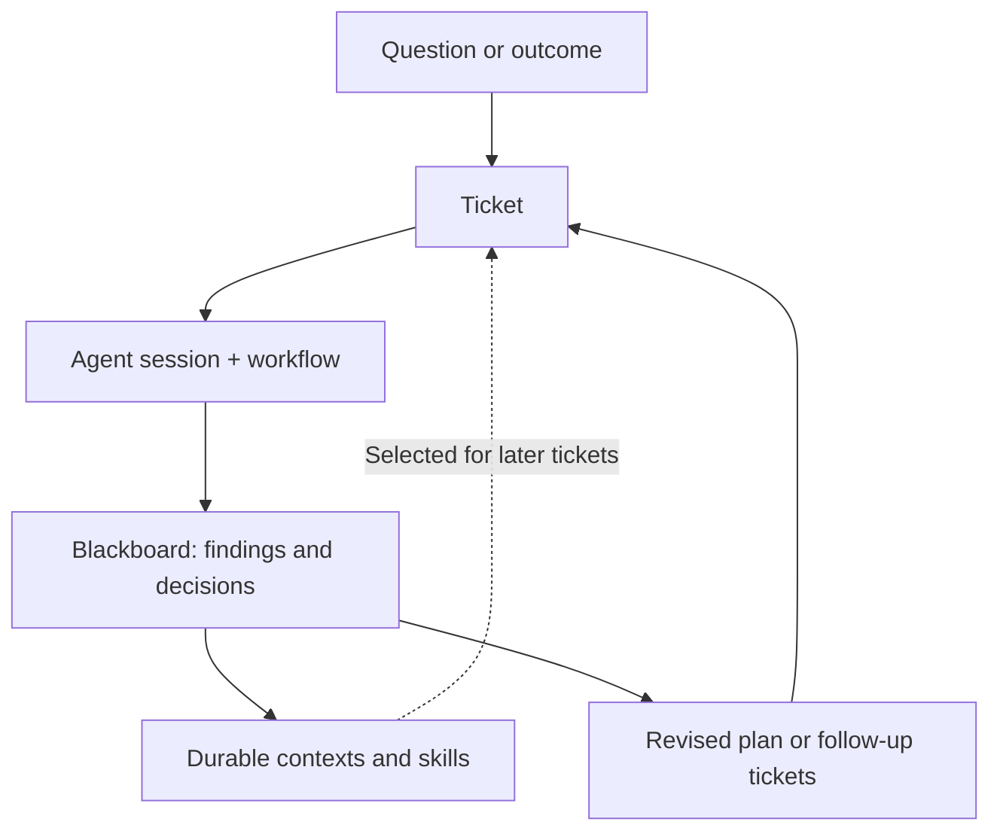

# Coga

**Build. Rethink. Hack.**

Coga is a local, Git-backed CLI for working with coding agents through editable tasks, knowledge, and workflows.

So why build another agent tool when so many already exist?

Because none of the tools I've tried—and I've tried a lot—helped me work the way I want to.

I love making things. I want agents to help me think, explore, challenge assumptions, and build—not outsource my thinking just to maximize output. Decisions, friction points, and ways of working should stay visible and open to change. I want to hack the factory, not just the software it produces.

| | Principle | What it means |
|:--:|---|---|
| 🧠 | **Human agency** | Keep people in control of what matters. Delegate by choice, not by default. |
| 🔄 | **Continuous discovery** | Let what you learn challenge what you know and change what you build next. |
| 🛠️ | **Hackable system** | Own and reshape your tools, knowledge, and ways of working. |

[Browse Coga's own tickets](https://github.com/FastJVM/coga/tree/main/coga/tasks)

## How the plan evolves

You don't need a finished specification to start. A ticket can be a question to research, a decision to make, or an implementation task. The work can change the plan, and what you learn can shape the next task.



Tickets and their blackboards capture the work in progress. Contexts and skills keep reusable knowledge beyond an individual ticket; that knowledge can guide later sessions, while discoveries can change which work comes next.

1. **Start with a question or outcome.** `coga build` can propose an initial plan; `coga ticket` helps discuss and refine one task. Both leave editable tickets, not a fixed spec.
2. **Work and record what changes.** `coga launch` gives the agent the ticket, selected contexts, and current workflow step. Findings, decisions, and open questions can go into the ticket's blackboard.
3. **Keep what outlives the ticket.** Move shared constraints and decisions into project contexts, and reusable procedures into skills. Work tickets can be retired without discarding the useful knowledge they produced.
4. **Replan from the findings.** Revise, split, defer, or create tickets, then launch the next session with the updated context. Use human review gates or delegate unattended work where appropriate.

This keeps the plan *evolvable*, not automatically correct. Humans can inspect, challenge, and correct both the work and what gets carried forward.

## See the workflow

In an existing Git repository, after installing Coga (replace `YOUR_NAME`
with the name you want Coga to use for you):

```sh
coga init --user YOUR_NAME
coga ticket "Add a health-check endpoint"                 # discuss and draft a ticket
coga show add-a-health-check-endpoint                    # inspect the ticket and history
coga launch add-a-health-check-endpoint --prompt-report  # inspect the prompt layers
coga launch add-a-health-check-endpoint                  # start the agent in your terminal
```

The ticket is an ordinary Markdown file under `coga/tasks/`. It can be a
question to investigate, not just a request for code.

**Example — challenge an assumption.** Suppose the agent proposes a health
check that returns `200` whenever the process is running. You spot the problem:
the process could be alive while its database is unavailable. You edit the
ticket's `## Description` to require readiness, not just liveness:

```md
### Readiness
Return `503` when the required database is unavailable.
```

Record the reason in the ticket's blackboard. If other tasks need this rule,
move it into a reusable project context and attach that context to those
tickets. On the next `coga launch`, the current ticket, selected contexts,
and workflow step form the agent's fresh prompt. The correction carries
forward without relying on the previous chat.

## Why use Coga instead of just the agent?

Keep using Claude Code or Codex to plan, investigate, implement, and review.
Coga makes the work around those agent sessions explicit and editable:

- **Shape the plan.** Review agent-proposed approaches and success criteria; split, defer, or cancel tasks when evidence changes the direction.
- **Carry decisions across sessions.** Use a ticket's blackboard for working findings, contexts for shared constraints, and skills for reusable procedures. Humans and agents can inspect and correct those Git-backed files.
- **Choose what the agent sees.** Attach relevant contexts and skills to the task rather than loading every note into every prompt.
- **Decide when to delegate.** Work interactively, route steps to another agent for peer review, add human gates, or queue stable work unattended. Blockers and explicit human gates interrupt unattended work.

The [research behind these choices](https://github.com/FastJVM/coga/blob/main/docs/contexts/coga-dev/principles/reading-list.md#context-skills-and-plan-review) covers context rot, selective guidance, and reviewing plans before implementation.

## When Coga changed its own mind

Coga is [built with Coga](https://github.com/FastJVM/coga/tree/main/coga/tasks). Its history contains architectural assumptions that changed after real use:

- **One repo, not a project federation.** Early Relay (Coga's original name) assumed one CLI should manage multiple projects through `[projects.*]` and `--project`. In practice, each repository configured only one project. The team [revised the spec](https://github.com/FastJVM/coga/commit/8dcd8c3d8241cad5028ca9f251e45db082b5f6a7), then [simplified the CLI and tests](https://github.com/FastJVM/coga/commit/3654b67d588c5f0000231377fa9bec5298b3db5f) rather than keeping an abstraction it didn't need.
- **A finding in a ticket is not necessarily durable knowledge.** Dream, Coga's recurring maintenance pass, originally ran cleanup before its knowledge scan, so some completed tickets were already gone when scanning began. Its findings also landed in a blackboard that would be retired with the task. The team [redesigned Dream](https://github.com/FastJVM/coga/commit/22532446c317c701e556720dd929060ef11e9689) to scan first and route discoveries to reviewable PRs, draft tickets, or recorded markers—not leave them only in temporary notes.

**Keeping history is not enough.** Important decisions must be promoted into durable guidance and selected for the next task that needs them. Coga's [tickets](https://github.com/FastJVM/coga/tree/main/coga/tasks) and [Git-backed history](https://github.com/FastJVM/coga/blob/main/coga/log.md) make that evolution inspectable.

## Get started

Coga runs inside an existing Git repository. You need Git, Python 3.11+
(`uv` can install it), and at least one coding agent CLI: Claude Code
(`claude`) or Codex (`codex`). Coga doesn't install those agents.

### Install on macOS or Linux

Check `git --version` first. On macOS, if Git asks for developer tools,
run `xcode-select --install`; full Xcode isn't required. On Linux,
install Git using your distribution's package manager.

If you don't have `uv` yet:

```sh
curl -LsSf https://astral.sh/uv/install.sh | sh
```

See [other uv installation methods](https://docs.astral.sh/uv/getting-started/installation/).
Open a new terminal if `uv` isn't on your `PATH`, then run:

```sh
uv tool install coga
coga --version
```

### Install on native Windows

Use PowerShell (for example, in Windows Terminal) and install Git for Windows.
The published PyPI release 0.4.1 predates Coga's native Windows support,
so install the current GitHub source version instead:

```powershell
irm https://astral.sh/uv/install.ps1 | iex
uv python install 3.11
uv tool install --python 3.11 "git+https://github.com/FastJVM/coga.git@main"
coga --version
```

Native Windows has been tested on Windows Server 2025 with Claude Code's
native installer; Codex has not yet been tested there. Bash and WSL aren't
required, and Git for Windows's default `core.autocrlf=true` is supported.
`coga launch --idle-timeout` is unavailable on native Windows; use
`--max-session` for a wall-clock limit.

If `coga` isn't found after either installation, run `uv tool update-shell`
and open a new terminal.

### Initialize a repository

Change into your project's existing Git repository. Outside a Git repo,
`coga init` stops. Check `git var GIT_AUTHOR_IDENT`; if Git asks for an
identity, set `git config user.name "Your Name"` and
`git config user.email "you@example.com"` with your own details for this repo.

```sh
coga init --user YOUR_NAME
```

In a repo new to Coga, init commits the Coga files. In a clone that already
uses Coga, it sets up your local identity and agent links without a commit
([init details](https://github.com/FastJVM/coga/blob/main/src/coga/resources/templates/coga/bootstrap/contexts/coga/init/SKILL.md)).
Coga installs no agent CLI. In an interactive terminal, if exactly one
supported CLI is present, init offers to make it your default agent.
It seeds an onboarding ticket only for an otherwise empty repo; a short starter
README, LICENSE, or `.gitattributes` still counts as empty.

Choose how to begin:

```sh
# New, otherwise empty Git repo: discuss the idea and draft a first plan
coga build

# Repo with existing files: describe your first task
coga ticket "<title>"

# Check the current work
coga status
```

To use Codex explicitly, run `coga build --agent codex` or
`coga ticket "Your task title" --agent codex`.
In the shipped setup, chat and ticket interviews default to Claude even when
new tasks use Codex. You can also edit any ticket directly in Markdown.

For a walkthrough to a reviewed PR, follow [Your first task](https://github.com/FastJVM/coga/blob/main/src/coga/resources/templates/coga/bootstrap/contexts/coga/first-task/SKILL.md).
That path needs a GitHub remote you can push to and
[GitHub CLI](https://cli.github.com/) authentication (`gh auth login`).
The guide explains peer review using both agent CLIs and a workflow using
one agent. GitHub CLI is optional for init and work that does not use GitHub;
[1Password CLI](https://github.com/FastJVM/coga/blob/main/src/coga/resources/templates/coga/bootstrap/contexts/coga/secrets/SKILL.md)
is needed only for tickets declaring `op://` secrets.

Upgrade with `uv tool upgrade coga`. To remove Coga from a repo, run
`coga uninstall`; the [uninstall guide](https://github.com/FastJVM/coga/blob/main/src/coga/resources/templates/coga/bootstrap/contexts/coga/uninstall/SKILL.md)
explains what it removes and how to remove the global package too.

## What lives in your repo?

Everything Coga manages is visible under `coga/`:

- **Tickets** (`coga/tasks/`) — specific outcomes, attached context, workflow, and working notes. [How tickets work](https://github.com/FastJVM/coga/blob/main/src/coga/resources/templates/coga/bootstrap/contexts/coga/tickets/SKILL.md).
- **Contexts** — durable facts, constraints, and decisions you choose to attach to tasks. [How knowledge works](https://github.com/FastJVM/coga/blob/main/src/coga/resources/templates/coga/bootstrap/contexts/coga/knowledge/SKILL.md).
- **Skills** (`coga/skills/` or bundled) — reusable procedures selected for tickets and workflow steps. [How knowledge works](https://github.com/FastJVM/coga/blob/main/src/coga/resources/templates/coga/bootstrap/contexts/coga/knowledge/SKILL.md).
- **Workflows** — agent steps and human review gates. [How workflows work](https://github.com/FastJVM/coga/blob/main/src/coga/resources/templates/coga/bootstrap/contexts/coga/workflows/SKILL.md).
- **History** (`coga/log.md`) — task transitions kept separately from the prompt sent to an agent.

## Principles

Coga is built around a few deliberate choices:

**Text above code.** In most coding repos, code is the source of truth. In a Coga repo, the truth lives in the text. Code is an artifact "compiled" from it—and yes, we can regenerate it.

**Keep everything at human scale.** Coga stays small enough to understand and change. The tool should fit the way you work, not make you fit its process.

**Amplify agents, don't duplicate them.** Don't build another planner, researcher, coder, or reviewer. Use what coding agents already know. As they improve, Coga benefits.

**Coga encoded in Coga.** The same tickets, contexts, and workflows used for other projects should describe and evolve Coga itself.

## Learn more

- [Documentation](https://github.com/FastJVM/coga/blob/main/docs/README.md) — installation, concepts, operation, and development.
- [Design principles](https://github.com/FastJVM/coga/blob/main/docs/contexts/coga-dev/principles/SKILL.md) — the reasoning behind the workbench approach.
- [Contributing](https://github.com/FastJVM/coga/blob/main/CONTRIBUTING.md) — how to work on Coga.

Licensed under [Apache-2.0](https://github.com/FastJVM/coga/blob/main/LICENSE).
