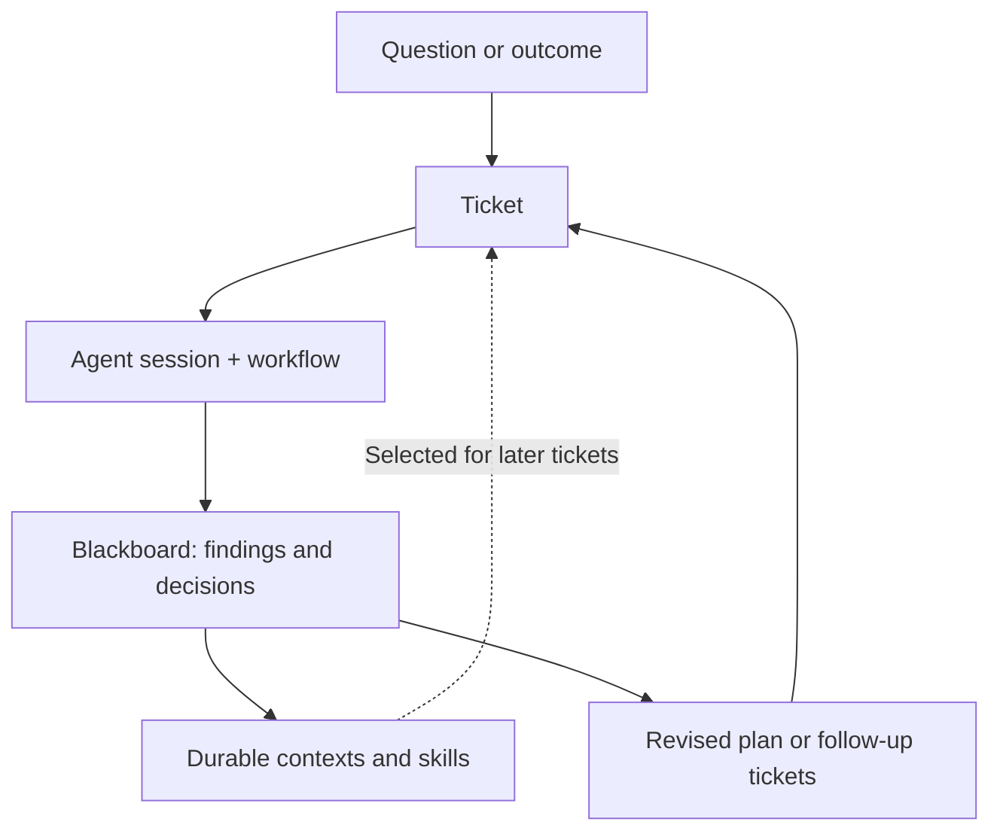

# Coga

**Agents work in sessions. Humans make things. Coga helps you build better and go deeper.**

Claude Code and Codex can plan, investigate, and implement tasks. But a software project outlives any agent session. Assumptions change, and a discovery in one task can overturn the next. Important constraints get buried in conversations and working notes—even when those records are saved. Finding and re-explaining them to each new agent takes work.

**Coga helps you keep a project moving without losing what you've learned along the way.** It's a local CLI for launching coding agents and tracking work around evolving project knowledge. Findings from temporary tickets can become durable contexts and skills, selected when later tasks need them. Plans, decisions, and constraints remain readable Markdown in Git, where humans and agents can inspect and correct them.

You can correct a constraint an agent missed, replace a disproven assumption, or retire instructions that no longer fit. The goal is not to load every past conversation into every prompt, but to carry forward the knowledge relevant to the work at hand.

For a specific task, `coga launch` brings its ticket, selected contexts, and current workflow step into your agent’s prompt, using the current files. You choose the knowledge the task needs, with as much help from an agent as you want.

Guide sessions interactively, add human review gates, or queue work to run unattended. **Discover and build progressively. Delegate as much—or as little—as you want.**

[Browse Coga's own tickets](https://github.com/FastJVM/coga/tree/main/coga/tasks)

## How the plan evolves

You don't need a finished specification to start. A ticket can be a question to research, a decision to make, or an implementation task. The work can change the plan, and what you learn can shape the next task.



Tickets and their blackboards capture the work in progress. Contexts and skills keep reusable knowledge beyond an individual ticket; that knowledge can guide later sessions, while discoveries can change which work comes next.

1. **Start with a question or outcome.** `coga build` can propose an initial plan; `coga ticket` helps discuss and refine one task. Both leave editable tickets, not a fixed spec.
2. **Work and record what changes.** `coga launch` gives the agent the ticket, selected contexts, and current workflow step. Findings, decisions, and open questions can go into the ticket's blackboard.
3. **Keep what outlives the ticket.** Move shared constraints and decisions into project contexts, and reusable procedures into skills. Work tickets can be retired without discarding the useful knowledge they produced.
4. **Replan from the findings.** Revise, split, defer, or create tickets, then launch the next session with the updated context. Use human review gates or delegate unattended work where appropriate.

This keeps the plan *evolvable*, not automatically correct. Humans can inspect, challenge, and correct both the work and what gets carried forward.

## See the workflow

In an existing Git repository, after installing Coga:

```sh
coga init --user <your-name>
coga ticket "Add a health-check endpoint"                 # discuss and draft a ticket
coga show add-a-health-check-endpoint                    # inspect the ticket and history
coga launch add-a-health-check-endpoint --prompt-report  # inspect the prompt layers
coga launch add-a-health-check-endpoint                  # start the agent in your terminal
```

The ticket is an ordinary Markdown file under `coga/tasks/`. It can hold an unresolved question, not just a request for code. For example, [a Coga ticket about oversized blackboards](https://github.com/FastJVM/coga/blob/main/coga/tasks/document-the-remedy-for-a-bloated-blackboard-sibli.md) came from a Dream scan: two other tickets had independently found the same remedy, but no shared guidance existed for the next agent. The follow-up captured the remedy in durable project knowledge rather than leaving it in two separate task histories.

At launch, Coga assembles the ticket, its selected contexts, and its current workflow step into a fresh prompt. You can inspect and edit what the next session sees.

## Why use Coga instead of just the agent?

You keep using Claude Code or Codex to plan, investigate, and build. Coga gives you a shared plan and working knowledge that you can inspect, correct, and carry across sessions:

- **Understand and shape the plan.** Let the agent propose an approach, then read and refine what it intends to build. Add missing constraints, question assumptions, and decide what success means. The same edited plan helps you judge the work and gives the agent direction.
- **Manage context rot with readable handoffs.** At each step, the agent records useful findings, decisions, and open questions. The next session starts fresh from the current ticket, notes, and selected knowledge. You can inspect, correct, and share what carries forward.
- **Choose knowledge and skills for the task.** Select the facts, constraints, and procedures to include at launch. Make important guidance available from the start, and keep irrelevant or outdated instructions out of the task's prompt.
- **Change the plan as you learn.** Split a vague task, test an assumption first, cancel work, or change the next step after seeing new evidence.
- **Let prepared tasks run with less steering.** A clear ticket plus relevant contexts and step skills gives an agent more of what it needs before it starts. Coga can continue across agent-assigned steps, including peer review, and stop at blockers or explicit human gates instead of asking you to restate project knowledge each session.
- **Put reviews where they matter.** Work interactively, add human review gates, or delegate work to run unattended. Choose the points where you want to check the plan, findings, or implementation.
- **Keep what you learn.** Record useful discoveries in project contexts and reusable methods in skills so later tasks can draw on them, even when a different agent does the work.

The [research behind these choices](https://github.com/FastJVM/coga/blob/main/docs/contexts/coga-dev/principles/reading-list.md#context-skills-and-plan-review) covers context rot, selective guidance, and reviewing plans before implementation.

## When Coga changed its own mind

Coga is [built with Coga](https://github.com/FastJVM/coga/tree/main/coga/tasks). Its history contains architectural assumptions that changed after real use:

- **One repo, not a project federation.** Early Relay (Coga's original name) assumed one CLI should manage multiple projects through `[projects.*]` and `--project`. In practice, each repository configured only one project. The team [revised the spec](https://github.com/FastJVM/coga/commit/8dcd8c3d8241cad5028ca9f251e45db082b5f6a7), then [simplified the CLI and tests](https://github.com/FastJVM/coga/commit/3654b67d588c5f0000231377fa9bec5298b3db5f) rather than keeping an abstraction it didn't need.
- **A finding in a ticket is not necessarily durable knowledge.** Dream originally ran cleanup before its knowledge scan, so some completed tickets were already gone when scanning began. Its findings also landed in a blackboard that would be retired with the task. The team [redesigned Dream](https://github.com/FastJVM/coga/commit/22532446c317c701e556720dd929060ef11e9689) to scan first and route discoveries to reviewable PRs, draft tickets, or recorded markers—not leave them only in temporary notes.

**Keeping history is not enough.** Important decisions must be promoted into durable guidance and selected for the next task that needs them. Coga's [tickets](https://github.com/FastJVM/coga/tree/main/coga/tasks) and [Git-backed history](https://github.com/FastJVM/coga/blob/main/coga/log.md) make that evolution inspectable.

## Get started

Agent sessions run on Linux or macOS. You'll need Git and an authenticated [Claude Code](https://claude.com/claude-code) or [Codex](https://github.com/openai/codex) CLI to run agent sessions. Coga requires Python 3.11+, but the recommended `uv` installer can obtain a compatible Python for you.

On macOS, check that `git --version` works. If it prompts for developer
tools, run `xcode-select --install`; Git installed another way works too.
Full Xcode is not required. The [install guide](https://github.com/FastJVM/coga/blob/main/docs/contexts/coga/install/SKILL.md#macos-check-git-before-init)
covers this and Windows support limits.

If `uv` isn't installed yet, get it first (macOS/Linux):

```sh
curl -LsSf https://astral.sh/uv/install.sh | sh
```

See [other uv installation methods](https://docs.astral.sh/uv/getting-started/installation/).
Open a new terminal if `uv` isn't on your `PATH` after installation.

```sh
uv tool install coga
coga --version
cd <your-git-repository>
coga init --user <your-name>
```

In an interactive terminal, init offers agent CLI installation and login when neither supported CLI is installed. It seeds the onboarding ticket only for an otherwise empty repo; a stock README, LICENSE or `.gitattributes` still counts as empty. Make sure your chosen agent CLI is signed in, then choose how to begin:

```sh
# New, otherwise empty Git repo: discuss the idea and draft a first plan
coga build

# Existing project: discuss what's next
coga chat

# Check the current work
coga status
```

You can edit any ticket directly in Markdown or run `coga ticket <slug>` to refine it with an agent. For a walkthrough from a draft to a reviewed PR, see [Your first task](https://github.com/FastJVM/coga/blob/main/docs/contexts/coga/first-task/SKILL.md).

## What lives in your repo?

Everything Coga manages is visible under `coga/`:

- **Tickets** (`coga/tasks/`) — specific outcomes, attached context, workflow, and working notes. [How tickets work](https://github.com/FastJVM/coga/blob/main/docs/contexts/coga/tickets/SKILL.md).
- **Contexts** — durable facts, constraints, and decisions you choose to attach to tasks. [How knowledge works](https://github.com/FastJVM/coga/blob/main/docs/contexts/coga/knowledge/SKILL.md).
- **Workflows** — agent steps and human review gates. [How workflows work](https://github.com/FastJVM/coga/blob/main/docs/contexts/coga/workflows/SKILL.md).
- **History** (`coga/log.md`) — task transitions kept separately from the prompt sent to an agent.

## Principles

Coga is built around a few deliberate choices:

**Text above code.** In most coding repos, code is the source of truth. In a Coga repo, the truth lives in the text. Code is an artifact "compiled" from it—and yes, we can regenerate it.

**Keep everything at human scale.** Coga stays small enough to understand and change. The tool should fit the way you work, not make you fit its process.

**Amplify agents, don't duplicate them.** Don't build another planner, researcher, coder, or reviewer. Use what coding agents already know. As they improve, Coga benefits.

**Coga encoded in Coga.** The same tickets, contexts, and workflows used for other projects should describe and evolve Coga itself.

## Learn more

- [Documentation](https://github.com/FastJVM/coga/blob/main/docs/README.md) — installation, concepts, operation, and development.
- [Design principles](https://github.com/FastJVM/coga/blob/main/docs/contexts/coga-dev/principles/SKILL.md) — the reasoning behind the workbench approach.
- [Contributing](https://github.com/FastJVM/coga/blob/main/CONTRIBUTING.md) — how to work on Coga.

Licensed under [Apache-2.0](https://github.com/FastJVM/coga/blob/main/LICENSE).
